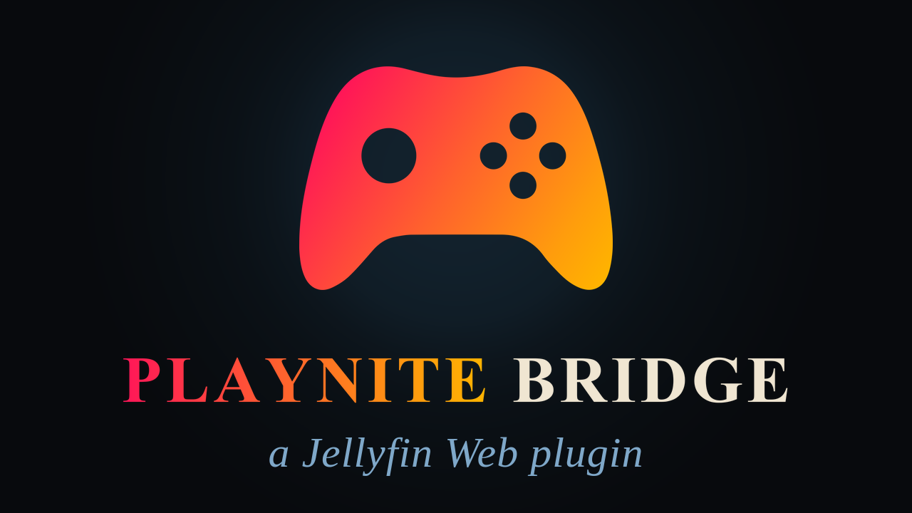

[Jellyfin Projects](https://linktr.ee/JellyfinProjects) | [Kodi Projects](https://linktr.ee/KodiProjects)

---



*Not affiliated with or endorsed by Jellyfin or Playnite.*

---

**Alpha.** Playnite Bridge is an early public version. It works, but expect rough edges, and settings or behaviour may still change. Feedback and bug reports are very welcome.

---

My games live in [Playnite](https://playnite.link): Steam, GOG, Ubisoft, EA, Epic and everything else in one library. My films and series live in Jellyfin. I wanted both in one place, my games as a library in Jellyfin, browsed like my films, with posters, backdrops, trailers and extras. Not with a second database to keep in sync, and not with fake video files that only exist to fool Jellyfin.

So I built Playnite Bridge. It reads Playnite's library and shows the games in a Jellyfin library of their own, and Jellyfin's database never gets a single game in it.

Please also have a look at my other plugins:

- [ArtworkPlus](https://github.com/chrissix666/Jellyfin-ArtworkPlus): shows the artwork Jellyfin leaves unused
- [Cinema Project](https://github.com/chrissix666/Jellyfin-Cinema-Project): a virtual cinema environment based on three.js that gives your movies an ambient feel
- [VideoOSD Tweaks and Candy](https://github.com/chrissix666/Jellyfin-VideoOSD-Tweaks-Candy): puts you in full control of the Jellyfin video player OSD
- [Destroy](https://github.com/chrissix666/Jellyfin-Destroy): turns the Jellyfin page you are looking at into a game level
- [VisoMaster Bridge](https://github.com/chrissix666/Jellyfin-VisoMaster-Bridge): swaps faces in the film you are watching, with [VisoMaster Fusion](https://github.com/VisoMasterFusion/VisoMaster-Fusion)

---

# Jellyfin Playnite Bridge

- [What This Is](#what-this-is)
- [What This Is Not](#what-this-is-not)
- [Under the Hood](#under-the-hood)
  - [Architecture](#architecture)
  - [The Copy of Playnite's Data](#the-copy-of-playnites-data)
  - [Game Folders](#game-folders)
- [Requirements](#requirements)
- [Installation](#installation)
- [First Setup](#first-setup)
- [Sync](#sync)
- [General](#general)
- [Library View](#library-view)
  - [Tiles](#tiles)
  - [Versions and Grouping](#versions-and-grouping)
  - [Hide Titles](#hide-titles)
  - [Collections](#collections)
- [Detail Pages](#detail-pages)
  - [Info Lines and Detail Rows](#info-lines-and-detail-rows)
  - [Version Dropdown](#version-dropdown)
  - [Start Buttons](#start-buttons)
  - [Links](#links)
- [Versions](#versions)
- [Artwork](#artwork)
  - [Sources](#sources)
  - [Artwork on Version Change](#artwork-on-version-change)
  - [Display](#display)
- [Extras](#extras)
  - [Connections](#connections)
  - [Documents](#documents)
  - [Wallpapers & Artwork](#wallpapers--artwork)
  - [Screenshots](#screenshots)
  - [Videos](#videos)
  - [Theme Videos](#theme-videos)
  - [Theme Music](#theme-music)
  - [Soundtrack](#soundtrack)
  - [Player Artwork](#player-artwork)
- [Curator](#curator)
- [Works with ArtworkPlus and VideoOSD Tweaks and Candy](#works-with-artworkplus-and-videoosd-tweaks-and-candy)
- [Parental Controls](#parental-controls)
- [Settings Management](#settings-management)
- [Settings Not Applying?](#settings-not-applying)
- [Limits](#limits)
- [Developed For & Tested On](#developed-for--tested-on)
- [Credits](#credits)
- [License](#license)

---

**Playnite Bridge shows your Playnite library in Jellyfin. Every game from every store, as a poster tile in a library of its own, with a detail page, versions, extras, theme music and a start button, and without adding a single entry to Jellyfin's database.**

---

## What This Is

A Jellyfin plugin that turns your [Playnite](https://playnite.link) library into a Jellyfin library. Pick a movies library, call it Games, and the games from Playnite appear in it like movies: poster tiles, Jellyfin's own tabs, sort, filters and paging, and a detail page.

Playnite already knows all your games: Steam, Epic, GOG, EA, Ubisoft, Xbox, Battle.net, Amazon, Humble, itch.io, IndieGala, PlayStation, Rockstar, Riot, and every game you added by hand. Playnite Bridge reads that and presents it in Jellyfin, right next to your films and series.

The detail page shows what Playnite knows: description, release year, playtime, ratings, genres, developer, publisher, platform, features, install size, completion status and links. The same game from several stores is one tile, with a version dropdown and the store icons on the cover.

Then it goes further. A game can have trailers, special features, screenshots, wallpapers, manuals, a soundtrack, theme music and theme videos, all read from folders next to the game. The Steam store videos of a game can play in Jellyfin's own player. And a button on the detail page opens the game in Playnite, starts it or installs it.

Playnite stays the only source. Playnite Bridge reads it and never writes into it.

**The key points**

- **It looks like vanilla Jellyfin.** No experiments. The library, the tiles and the detail page look and behave like those of a movie. Playnite Bridge only differs where something is specific to games: the version dropdown, the platform marker, the start buttons.
- **Nothing is written into Jellyfin's database.** The games are virtual entries. A publisher does not suddenly turn up as a director. Everything stays completely independent of your films and series.
- **Playnite's metadata and artwork stay untouched.** Playnite Bridge only reads them. In return, it expects you to curate your metadata and artwork in Playnite if you want everything to look its best. Importing the artwork into Jellyfin is optional, per artwork type. Keep it in sync with Playnite all the time, use it once as a starting point, or leave it out and work with your own artwork in Playnite Bridge, independent of Playnite. If you want it independent, check the artwork modes first, so that nothing is overwritten afterwards, see [Sources](#sources).
- **A lot of artwork features.** Backdrops with a cycle time, Ken Burns zoom and pan and an order you choose, for the detail page, the library and collections. LogoArt for the clearlogo slot. CharacterArt in four positions, also as a slideshow. Posters in a size and anchor of your choice.
- **A lot of extras, beyond vanilla.** Trailers and special features, screenshots, wallpapers and artwork, documents, a soundtrack, theme music and theme videos, and Connections to collections, movies, TV shows and actors. Everything vanilla Jellyfin has for a movie is there, and more.
- **Remote start and install, your way.** Start or install a game through Playnite or straight through the store's launcher, per platform, from the server PC or remotely from another device. Which buttons exist, and who may use them, is up to you.
- **Version handling Playnite does not have.** Playnite has no versions. Playnite Bridge can group the same game from different platforms, and its editions, into one tile with a version dropdown. You decide how much of it you want. Switch **Group Games** off and every game is listed on its own, as in Playnite. Switch it on and shape it: which version is the main one, in which order the platforms count, which words mark an edition, a demo or a test build, whether roman numerals count as equal, and which titles are never grouped. There are enough setting variations to show your library exactly the way you want it.
- **Shape it the way you want.** Nearly everything can be switched on or off, renamed, reordered and merged. Playnite Bridge can be the one place where all the metadata of your games comes together.

---

## What This Is Not

Playnite Bridge is not a game launcher, not a replacement for Playnite, not a game streaming tool, and not a metadata scraper.

It does not play games inside Jellyfin. A start button asks Playnite or the store to start the game on the PC where Jellyfin runs, and the game opens there.

It does not download metadata or artwork from the web into your library. The one thing it asks the internet for, and only if you switch it on, is the list of videos on a game's Steam store page (Steam Special Features). Pictures from Steam are read from the Steam installation on the PC.

It does not fill Jellyfin's database. The games exist only as virtual entries in the library you chose. Nothing is imported, scanned or scraped by Jellyfin.

It does not change Playnite's data. Playnite's folder is only ever read.

---

## Under the Hood

### Architecture

Playnite Bridge is a native Jellyfin plugin with three layers.

The core is written in **C#** and runs server-side. It reads a copy of Playnite's database, answers Jellyfin's requests for the Games library with virtual entries (tiles, lists, filters, detail data, images), and stores all settings in the Jellyfin backend.

On top of that, a **JavaScript** script draws everything the game pages add in the browser: the version dropdown, the version marker on the cover, the start buttons, the extras rows, the theme music and theme videos.

The script is added to Jellyfin Web through the File Transformation plugin.

### The Copy of Playnite's Data

Playnite keeps its library in database files that Playnite itself has open while it runs. So Playnite Bridge does not read them in place. A **sync** copies the files it needs into the plugin's own data folder, and every request is answered from that copy.

- A sync only runs while **Playnite is closed**. If Playnite is running, nothing is copied and the sync says so.
- Exactly one copy exists. Every sync overwrites it.
- The copy is not part of Jellyfin's backup. It can always be made again from Playnite.

Games you add, change or remove in Playnite show up in Jellyfin after the next sync.

### Game Folders

Every game gets a folder of its own, made by Sync Metadata. It is named after the game's title and ends with a short number in square brackets, for example `Half-Life 2 [1a2b3c4d]`. That number is how the plugin finds the folder, so it must stay in the name. The title in front can change; the plugin finds the folder by the number.

The folders are created in a folder named `Games` inside Jellyfin's metadata folder. The **Game Folder** setting changes where.

Your own files go into the game's folder: artwork, extras, trailers, documents, screenshots, a soundtrack, theme music. Each game and each version has its own folder, so each is independent.

---

## Requirements

- Jellyfin 10.10.7 or 12.0+
- [Playnite](https://playnite.link) 10, installed on the **same PC** as the Jellyfin server. Playnite Bridge reads its database files from disk.
- The [File Transformation Plugin](https://github.com/IAmParadox27/jellyfin-plugin-file-transformation). Without it the server part works, but none of the game page additions reach the browser.
- A **movies library** in Jellyfin for the games. It must hold no media of its own.

Jellyfin must be allowed to read Playnite's folder. By default Playnite Bridge looks in `%AppData%\Playnite` of the Windows account that runs Jellyfin. If Jellyfin runs under another account than Playnite, for example as a service, enter Playnite's folder yourself under **Playnite Folder**, and make sure that account may read it. The folder must be a local path with a drive letter. Network paths are not accepted.

Starting and installing games through the buttons also needs the server PC, see [Start Buttons](#start-buttons).

Playnite Bridge runs in Jellyfin Web, in a desktop browser. See [Limits](#limits) for the rest.

A word on Jellyfin versions: the plugin comes as two builds, 1.x for 10.10.7 and 2.x for 12.0+. It is one and the same source, and Jellyfin's plugin catalog automatically offers the one that matches your server. Versions in between (like 10.11) are untested.

---

## Installation

Requires the [File Transformation Plugin](https://github.com/IAmParadox27/jellyfin-plugin-file-transformation) to be installed first.

**Via Plugin Catalog (recommended)**

1. In Jellyfin, go to Dashboard > Plugins > Repositories
2. Add a new repository:
   - **Name:** anything you like, for example `Playnite Bridge`
   - **URL:**

```
https://raw.githubusercontent.com/chrissix666/Jellyfin-Playnite-Bridge/main/manifest.json
```

3. Go to the Catalog tab, find Playnite Bridge (category: Experimental), and install it
4. Restart Jellyfin
5. Continue with [First Setup](#first-setup)

**Manual Installation**

1. Download the latest release ZIP from the [Releases page](https://github.com/chrissix666/Jellyfin-Playnite-Bridge/releases), the one for your Jellyfin version: `_jellyfin-10.10.7.zip` (1.0.0.0) for Jellyfin 10.10.7, `_jellyfin-12.x.zip` (2.0.0.0) for Jellyfin 12.0+
2. Extract the whole ZIP, including all files next to the plugin DLL, into its own folder inside your Jellyfin plugins folder, for example `plugins/Playnite Bridge`
3. Restart Jellyfin
4. Continue with [First Setup](#first-setup)

---

## First Setup

1. Make sure Playnite has been started at least once and your games are in it. Then **close Playnite**.
2. In Jellyfin, create a library of the type **Movies**, named `Games`, with an empty folder. This library shows the games. It must not hold any real media. A library that does is not used as the games library.
3. Open Dashboard > Plugins > Playnite Bridge, tab **General**.
4. **Playnite Folder:** leave empty to read `%AppData%\Playnite`, or enter the folder.
5. **Library:** the name of your library, `Games` by default. **Library Id** overrides the name, if you prefer an id.
6. Save, then run **Sync All** (the Sync button on the General tab, or Dashboard > Scheduled Tasks, category Playnite Bridge).
7. Reload Jellyfin Web. The games are in your library.

From here on everything else is optional. The defaults already give you tiles, detail pages and start buttons. The rest of this page walks through every tab of the settings.

---

## Sync

Sync is how new games, changed data and your own files get into Jellyfin. There are four parts, available as buttons on the General tab and as scheduled tasks under the category **Playnite Bridge**. None of them has a schedule by default, add one if you like.

- **Sync Metadata:** copies Playnite's database while Playnite is closed, makes the game folders and cleans up
- **Sync Artwork:** copies the pictures of the sources you chose into the game folders and computes their BlurHash
- **Sync Extras:** makes the thumbnails and trickplay of local extra videos, and lists documents that need a thumbnail
- **Sync All:** runs the three one after the other

---

## General

The General tab holds the basics, the sync, the Curator and the cleanup.

**Settings**

- **Playnite Folder:** where Playnite's data is. Empty reads `%AppData%\Playnite`.
- **Library** and **Library Id:** which Jellyfin library shows the games
- **Games Library Icon:** Jellyfin default, Controller, Gamepad, Handheld or Tile, shown in the menu, on the home page, on tiles and in the dashboard
- **Show Hidden Games:** shows the games hidden in Playnite like all others
- **Apply Parental Controls:** see [Parental Controls](#parental-controls)
- **Dim Uninstalled Games:** darkens the tiles of games that are not installed
- **Dim Strength:** how much, in percent
- **Game Folder:** where the game folders are made
- **Separate Extras Folder** and **Extras Folder:** reads extras, theme media and the area folders from a folder of its own instead of the game folder. The folder is found by the short number in its name.

**Cleanup**

Folders in the game and extras folders whose game is gone from Playnite. Nothing happens by itself. Select the folders and choose the action:

- **Recycle Bin**
- **Move Aside**
- **Delete Permanently**

Folders larger than the Recycle Bin limit of the drive are deleted permanently.

---

## Library View

### Tiles

How the games look in the library.

**Settings**

- **List Image:** the picture the list view shows beside a game. Icon, Icon then Square, Square, or Square then Icon, with the cover as the last fallback.
- **Played Mark:** which games get Jellyfin's played check mark and count as played in the filters. Off, Started or Completed.

### Versions and Grouping

The same game from several stores becomes one tile. Open it, and a dropdown offers every version.

**Settings**

- **Group Games:** shows the same game from several platforms as one tile. Off lists every version on its own.
- **Group Editions:** also groups editions such as Remastered or Definitive Edition with the base game
- **Marker Kind:** how a tile shows that its game has several versions. Platform Icons, Number or Off.
- **Marker Position:** the corner of the tile, Top Left, Top Right, Bottom Left or Bottom Right
- **Show Marker:** Only for Several Versions, or For All Games
- **Most Icons:** 2 to 5. More platforms show one icon fewer and an ellipsis.
- **Main Version Order:** which version a tile stands for and opens first. Installed then Last Played, Last Played then Installed, Installed Only, Last Played Only, Platform List Only. The platform list is always the last step.
- **Platform List:** the order of the platforms that decides the main version when everything else is equal

### Hide Titles

Playnite libraries often hold demos, soundtracks and DLC next to the games. Hide them by word.

- **Demos**
- **Test Builds**
- **Soundtracks**
- **DLC and Packs**
- **Prologues and Trials**
- **Hide These Titles:** whole titles, whatever else matches
- **Never Hide These Titles:** titles that stay visible although a word or a list hides them

Each list has its own switch and its own words, one per line, and a Scenario Test button.

### Collections

Games of the same series, when the series has games in at least two groups, form a collection with a poster of its own.

**Settings**

- **Poster Order:** which game's cover is the poster of a collection, among the games that have one. Earliest Release, Latest Release, First by Name, Newest Added or Highest Score.
- **Own Pictures Folder:** a folder with one subfolder per series, named like the series, holding a poster and backdrop pictures for that collection.

Backdrops for collections are set on the [Artwork](#display) tab.

---

## Detail Pages

### Info Lines and Detail Rows

**Media Info Line**

The parts of the info line under the title that are shown: Year, Playtime, Age Rating, Community Rating, Critic Rating.

**Second Info Line**

- **Show Last Played:** the date the game was last played
- **Show Added:** the date the game was added to Playnite
- **Second Info Line Order:** Last Played then Added, or Added then Last Played

**Detail Rows**

Which rows of a game page are shown: Series, Genres, Developer, Publisher, Platform, Features, Size, Status.

**Series**

- **Show Series As:** Off, Text, Tiles or Both. The tiles also need Enable Connections.
- **Series Term:** the word shown in front of a game's series. A custom word is possible.

**Other**

- **Row Order:** the order of the tile rows of a game page. A row whose feature is off stays in the list, greyed.
- **Show More Like This:** shows Jellyfin's More Like This row on a game page

### Version Dropdown

- **Show Other Platforms:** lists the same game from another store in the dropdown
- **Show Editions:** lists other versions of the game, such as Remastered
- **Marker Kind**, **Marker Position**, **Show Marker** and **Most Icons** for the cover, like the tile settings above. The cover shows the marker Only When the Dropdown Offers Versions, or Always.

### Start Buttons

Buttons on the game page open a game in Playnite, start it, or install it.

- **In Playnite:** opens the game's page in Playnite
- **Start via Playnite** and **Install via Playnite:** Playnite starts an installed game and installs one that is not installed
- **Direct start** and **Install:** through the store's own program or link, where the store has one

A game that cannot start or install directly does so via Playnite instead.

Which buttons exist is set per platform in a table. Tick the buttons you want for Steam, Epic, GOG, EA, Ubisoft, Xbox, Battle.net, Amazon, Humble, itch.io, IndieGala, PlayStation, Rockstar, Riot and custom games. A store only offers the buttons it can do: PlayStation games, and Xbox console games, only have Open in Playnite. An installed game shows the start buttons, a not installed game the install buttons, and Open always.

**On the server PC**

When you use Jellyfin in a browser on the PC that runs the server, the button hands a link to the browser (`playnite://`, `steam://` and the like), and the browser asks the registered program to open it.

**From another device**

From a phone or another computer the server starts the action on the PC. The button shows a small computer symbol to say so. Who may do that is set by **Remote Start**:

- Off
- Administrators Only (the default)
- All Users

Without the permission a remote user gets no buttons. Direct start of GOG, Rockstar and Riot games runs a program on the PC and needs Remote Start that is not Off.

### Links

The links Playnite holds for a game are shown on the page.

- **Link Host Limiter:** shows only the links of the hosts you check. With the limiter off, every host shows.
- **Link Display:** Text or Icon
- The arrows set the order of the links

---

## Versions

The Versions tab decides what counts as the same game.

- **Treat Roman Numerals as Equal:** a roman numeral at the end of a title counts as its number, II = 2
- **Edition Words:** removed from the end of a title when editions are grouped, for example Remastered, Definitive Edition, Game of the Year. One word or phrase per line.
- **Demo and Test Build Words:** groups demos and test builds below their game, never as the main version
- **Never Group These Titles:** keeps these titles apart and never shortens them by edition words

Every word list has a **Scenario Test** button. It shows which of your games a list would catch, before you save.

Every game stays independent in metadata and artwork, whatever it is grouped with. Grouping only decides what the library shows as one tile.

---

## Artwork

### Sources

Each artwork type has a source, a file name and a mode.

| Type | Source | File names |
|---|---|---|
| **Cover** | Playnite, Steam, Steam then Playnite, Playnite then Steam, Off | poster, folder, cover, default, or your own |
| **Backdrop** | Playnite, Steam, Steam then Playnite, Playnite then Steam, Off | backdrop, fanart, background, or your own |
| **Logo** | Playnite (ExtraMetadata), Steam, in either order, Off | clearlogo, logo, or your own |
| **Banner** | Off, Steam | banner, or your own |
| **Thumb** | Off, Steam | landscape, thumb, or your own |
| **Icon** | Playnite, Steam, in either order, Off | icon, or your own |

These types have no source. They are read from files you put into the game folder: **Square**, **Disc** (disc, cdart, discart), **Clearart**, **CharacterArt**, **Box 3D**, **Box Front**, **Box Back** and **Box Spine**.

Steam pictures are read from the Steam installation on the PC.

Every type has a **mode**:

- **Update:** replaces the copy when the source changes and fills what is missing
- **Keep:** only fills what is missing, never replaces
- **Nothing:** creates no Bridge image and leaves the files in the game folder as they are

Your own file in the game folder always wins over a copy, and Playnite Bridge never changes or deletes it. The mode decides what happens to the copies it makes itself, so it is the setting to check:

- To stay in sync with Playnite, use **Update**.
- To import once as a starting point, use **Keep**. Whatever is there is never replaced afterwards.
- To work with your own artwork independent of Playnite, use **Nothing**, or put your own files into the game folder. **Update** would replace the copies it made when Playnite's picture changes.

Backdrops follow Jellyfin's naming rules, so numbered files work too.

**Sync Artwork** copies the pictures of the sources into the game folders and computes their BlurHash. **Enable BlurHash** shows the blurred placeholder of a poster, backdrop or extra thumbnail while it loads.

Steam sometimes stores invisible or transparent logo files, so Steam is not recommended as the Logo source. Steam uses the same picture for Banner and Thumb.

### Artwork on Version Change

When you pick another version in the dropdown, the pictures follow or stay. For Cover, Backdrop, Logo, Clearart and CharacterArt each:

- **Follows Version:** shows the picked version's picture. Off keeps the first version's.
- **Keep When Version Has None:** keeps the first version's picture when the picked version has none

### Display

**Settings From** decides whose options draw the artwork of game pages:

- **Playnite Bridge:** its own options below
- **ArtworkPlus:** while [ArtworkPlus](https://github.com/chrissix666/Jellyfin-ArtworkPlus) is installed, its own, larger set of options applies. See [Works with ArtworkPlus and VideoOSD Tweaks and Candy](#works-with-artworkplus-and-videoosd-tweaks-and-candy).

Playnite Bridge's own options:

**Poster**

- **Poster size:** 10 to 200 percent
- **Anchor:** Default, Top left, Top center, Top right, Center left, Center, Center right, Bottom left, Bottom center, Bottom right

**LogoArt**

What goes into the clearlogo slot of the game page, how big it is and where it sits.

- **Source:** clearlogo, clearart, characterart or Hide
- **Fallback** and **Second fallback**, used when the source has no image
- Size and offsets for clearlogo and clearart
- For characterart: scale by height or width, height and max width or width and max height, align, offset
- **Multi image:** Order, Playback (loop or play once), Random start position, Display duration, Transition duration, and **If only 1 image is found**

**CharacterArt**

Characters cut out and placed on the game page, in one of four positions: top left, top right, bottom left, bottom right. Each position has its own scale, size, align, offset and fullscreen offset. Multi-image slideshow with order, playback, random start, display duration, transition duration and an optional delay before the first image.

**Backdrops: Detail View**

The game's own backdrops behind its page: cycle time, Ken Burns effect (zoom speed, pan speed), order and random start position.

**Backdrops: Library View**

Backdrops behind the library page, with the same settings.

**Backdrops: Collection View**

Backdrops on the page of a collection.

- **Source:** the collection's own pictures, the games' backdrops, own then games, or Mixed
- **Own images** and **Game images:** Single or Multiple, each with an order
- **Game order:** Release date ascending, Release date descending, Shuffle, Random
- **Random start position**
- Cycle time and Ken Burns effect

---

## Extras

A game can come with more than a poster. Everything below is read from the game's folder, or from the Extras Folder if you keep it separate. Playnite Bridge never changes your own files. What it adds itself are the artwork copies of Sync Artwork, the thumbnails and trickplay of Sync Extras, and the files of the [Curator](#curator).

Each extras area has the same set of display options:

- **Display:** One Row per Slot, Merged, or Adaptive. Merged joins the slots ticked in Merge, and Adaptive does so only while two of them have files.
- **Keep Slots Together** and **Show Dividers**
- **Show Title** and **Show Subtext**
- **Tile Shape:** Landscape, Portrait, Square or Auto
- **Picture Fit:** Adaptive, Crop or Blur Fill, with a **Crop Limit** in percent for Adaptive
- **Sort:** Name Ascending, Name Descending, Date Ascending, Date Descending or Random
- A **title** for the merged row, from a short list or your own
- **Slots:** a slot is a folder inside the area's folder. Tick On to use a slot and Merge to join the merged row. Give each slot a label of your own if you like.

### Connections

Connections link a game to the rest of your Jellyfin library, through a file named `game.nfo` in the game's folder.

Five real examples. Only the id is needed. The name is a fallback for when you have no id, and it can stay empty. The `<order>` line sets the order inside each kind. The comments are free.

**Collection plus movies:** LEGO Harry Potter: Years 1-4. Only ids, the names stay empty.

```xml
<?xml version="1.0" encoding="UTF-8" standalone="yes"?>
<game>
    <!-- Harry Potter film series -->
    <media>
        <tmdbset>1241</tmdbset>
        <setname></setname>
        <order>0</order>
    </media>
    <!-- Harry Potter and the Philosopher's Stone (Extended) -->
    <media>
        <tmdb>671</tmdb>
        <moviename></moviename>
        <order>0</order>
    </media>
    <!-- Harry Potter and the Chamber of Secrets (Extended) -->
    <media>
        <tmdb>672</tmdb>
        <moviename></moviename>
        <order>1</order>
    </media>
    <!-- Harry Potter and the Prisoner of Azkaban -->
    <media>
        <tmdb>673</tmdb>
        <moviename></moviename>
        <order>2</order>
    </media>
    <!-- Harry Potter and the Goblet of Fire -->
    <media>
        <tmdb>674</tmdb>
        <moviename></moviename>
        <order>3</order>
    </media>
</game>
```

**One movie, no collection, with cast:** Star Trek: Hidden Evil. This is done on purpose. The game could also be connected to the Star Trek collection, the Star Trek: The Next Generation collection or the Star Trek: The Next Generation TV show. It is only an example of how you can have it. In this case the game belongs directly to one movie, so the sets and series are left out.

```xml
<?xml version="1.0" encoding="UTF-8" standalone="yes"?>
<game>
    <!-- Star Trek: Insurrection -->
    <media>
        <tmdb>200</tmdb>
        <moviename></moviename>
        <order>0</order>
    </media>
    <actor>
        <name>Patrick Stewart</name>
        <role>Captain Jean-Luc Picard</role>
        <order>0</order>
    </actor>
    <actor>
        <name>Brent Spiner</name>
        <role>Lt. Commander Data</role>
        <order>1</order>
    </actor>
    <actor>
        <name>Donna Murphy</name>
        <role>Anij</role>
        <order>2</order>
    </actor>
</game>
```

**Collection plus TV show:** RoboCop: Rogue City

```xml
<?xml version="1.0" encoding="UTF-8" standalone="yes"?>
<game>
    <!-- RoboCop film series -->
    <media>
        <tmdbset>5547</tmdbset>
        <setname></setname>
        <order>0</order>
    </media>
    <!-- RoboCop TV show -->
    <media>
        <tvdb>75981</tvdb>
        <showname></showname>
        <order>0</order>
    </media>
</game>
```

**Name as the fallback:** Bud Spencer & Terence Hill - Slaps And Beans. There is no id here, so the collection is found by its name. The actors have no role, so the role stays empty.

```xml
<?xml version="1.0" encoding="UTF-8" standalone="yes"?>
<game>
    <!-- Bud Spencer &amp; Terence Hill - 20er Mega Collection -->
    <media>
        <tmdbset></tmdbset>
        <setname>Bud Spencer &amp; Terence Hill - 20er Mega Collection</setname>
        <order>0</order>
    </media>
    <actor>
        <name>Bud Spencer</name>
        <role></role>
        <order>0</order>
    </actor>
    <actor>
        <name>Terence Hill</name>
        <role></role>
        <order>1</order>
    </actor>
</game>
```

**Cast only:** Beyond: Two Souls

```xml
<?xml version="1.0" encoding="UTF-8" standalone="yes"?>
<game>
    <actor>
        <name>Elliot Page</name>
        <role>Jodie Holmes</role>
        <order>0</order>
    </actor>
    <actor>
        <name>Willem Dafoe</name>
        <role>Nathan Dawkins</role>
        <order>1</order>
    </actor>
    <actor>
        <name>Kadeem Hardison</name>
        <role>Cole Freeman</role>
        <order>2</order>
    </actor>
    <actor>
        <name>Eric Winter</name>
        <role>Ryan Clayton</role>
        <order>3</order>
    </actor>
</game>
```

- **`<media>`** points to a movie (`tmdb` with `moviename`), a series (`tvdb` with `showname`) or a collection (`tmdbset` with `setname`) in your library, by id or, without an id, by name. They show as **Related Media**.
- **`<actor>`** lists the cast with `name` and `role`. A picture named like the actor, with spaces turned into underscores (`Elliot_Page.jpg`, also `.png`, `.jpeg` or `.webp`), in the game's `.actors` folder replaces the person's own picture.
- An optional `<order>` inside a block sets the order. Without it the file order counts.

**Settings**

- **Enable Connections**
- **Series**, **Related Media** and **Cast & Crew:** each shown as a Separate Row, in the Connections Row, or Off
- **Names** for the rows, from a short list or your own. Related Media: Related Media, Related, More from the Series. Cast & Crew: Cast & Crew, Characters.
- **Use Custom Pictures:** the pictures in the game's `.actors` folder
- **Connections Row:** the Row Name (Connections, Linked, Universe, Related or your own), **Name a Single Group by Its Own Name**, **Show Dividers** and the **Group Order**
- **Media Order:** collections, movies and TV shows inside the related media

### Documents

Manuals, guides, maps, books and articles, shown as rows that open in Jellyfin's reader (which needs the download right).

- **Folder:** `documents` by default
- **Slots:** manuals, guides, maps, books, articles, plus five of your own
- **Flat:** reads only the files directly in the folder as one row
- **Generate Thumbnails:** keeps a small preview of each PDF and comic archive in the cache, made on a visit and by Sync Extras

### Wallpapers & Artwork

Wallpapers and artwork as rows that open in Jellyfin's viewer.

- **Folder:** `wallpapers` by default
- **Slots:** wallpapers, fanart, concept, posters, boxart, renders, logos, icons, plus two of your own
- **Flat:** reads only the images directly in the folder as one row

### Screenshots

Screenshots as rows that open in Jellyfin's viewer.

- **Folder:** `screenshots` by default
- **Slots:** title, select, gameplay, gameover, highscores, plus five of your own
- **Flat:** reads only the images directly in the folder as one row

### Videos

Trailers and special features, played in Jellyfin's own player.

- **Enable Videos:** off leaves out trailers, special features and everything below from game pages
- **Enable Trailers:** named as Jellyfin names local trailers, in a `trailers` folder or with the `-trailer` ending
- **Enable Special Features:** named as Jellyfin names extras, from the game folder or the Extras Folder
- **Trailers of Other Versions** and **Special Features of Other Versions:** add those of the other versions to the shown version's (All Versions) or not (This Version Only)
- **Enable Steam Special Features:** the videos of the game's Steam store page, played in Jellyfin's player next to the special features. This asks Steam's public store for the game's AppID.
- **Steam Special Features Placement:** before or after the local ones
- **Special Features Title:** Special Features, Extras, Bonus Material or your own
- **Show Video Icon:** the camera on the cards of special features
- **Show Trickplay:** the seek bar thumbnails of extra videos that have a trickplay folder next to them
- **Create Now** and **Clear Trickplay:** Create Now runs Sync Extras, Clear Trickplay deletes every trickplay folder permanently

Special features sort into types and slots: extras, clips, behind the scenes, deleted scenes, interviews, scenes, samples, shorts and featurettes, plus ten slots of your own, each in a folder you name. Each type or slot can be shown, merged into Jellyfin's Special Features row, or get a row of its own with its own label.

A custom thumbnail is an image named like the video, `name.*` or `name-poster.*`, next to it. Without one, Sync Extras makes one.

### Theme Videos

Videos that play behind a game page instead of its backdrop.

- **Enable Theme Videos**
- **Sources:** theme videos, trailers and special features, ticked and ordered with the arrows
- **When Several Sources Are On:** First Available Only, or All Together
- **Play Mode:** Play First Only, Play All in Order, Play All Shuffled
- **Version Fallback:** takes another version's theme videos when the shown version has none
- **Loop Theme Videos**
- **On Version Switch:** Look for New Theme, or Keep Playing
- **Video Volume:** 0 is muted, and any sound pauses the theme music
- **Delayed Start** in seconds, optionally before every video

### Theme Music

Music that plays on a game page.

- **Enable Theme Music**
- **Version Fallback**
- **Play Mode:** Play First Only, Play One at Random, Play All in Order, Play All Shuffled
- **Loop Theme Music**
- **On Version Switch:** Look for New Theme, or Keep Playing
- **Theme Volume**
- **Delayed Start**, optionally before every song
- **Fade In** and **Fade Out** in seconds, optionally at every song

### Soundtrack

The audio files in a game's soundtrack folder, as a row on its page, played by Jellyfin's player.

- **Enable Soundtrack**
- **Soundtrack Title:** Soundtrack, Music, Original Soundtrack or your own
- **Soundtrack Folder:** `soundtrack` by default, holding the audio files and the cover
- **Soundtrack of Other Versions:** All Versions or This Version Only
- **Use Soundtrack as Theme Music:** plays the soundtrack as theme music when the game has no theme of its own

### Player Artwork

While a trailer or extra video plays, the player can show the game's artwork over the video. Layers: logo, clearart, disc, poster, thumb, banner and backdrops, each with its own position, offsets, maximum size and layer order.

**Settings From** decides whose values draw it: **Playnite Bridge** or **VideoOSD**. With VideoOSD, the Artwork addon of [VideoOSD Tweaks and Candy](https://github.com/chrissix666/Jellyfin-VideoOSD-Tweaks-Candy) draws the player artwork.

---

## Curator

Opening a game's link in Playnite is easy. Opening it from the file manager is not. The Curator writes files next to your games so that you can.

- **Generate Links** (General tab): puts one `.url` file per link of each game in a folder you can open in the file manager. **Links Folder** names it, **Where** puts it in the game folder, the extras folder or both, **Links on Every Sync** refreshes it with every sync.
- **Shortcuts:** a shortcut in each game folder that opens its extras folder, and one in each extras folder that opens its game folder. Both names can be changed. **Shortcuts on Every Sync** refreshes them.

**Update** writes and refreshes the files now, and **Delete All** removes only those made by the Curator.

The Curator only touches the files and shortcuts it lists as its own.

---

## Works with ArtworkPlus and VideoOSD Tweaks and Candy

Playnite Bridge works together with two of my other plugins. Both are optional.

**ArtworkPlus**

[ArtworkPlus](https://github.com/chrissix666/Jellyfin-ArtworkPlus) shows the artwork Jellyfin leaves unused: cases that open and spin their disc, keyart, extra posters, characterart and backdrops almost everywhere. It works with your games too. When it is installed and **Settings From** (Artwork tab, Display) is on ArtworkPlus, it takes over the artwork of game pages with all its options. Playnite Bridge then answers for the game itself: which pictures a game has, which version's pictures show, which games a collection holds and which backdrops belong to them. Every game and every version stays independent.

Set Settings From to Playnite Bridge and its own options draw the artwork.

**VideoOSD Tweaks and Candy**

[VideoOSD Tweaks and Candy](https://github.com/chrissix666/Jellyfin-VideoOSD-Tweaks-Candy) puts you in full control of the Jellyfin video player OSD. With its Artwork addon, it shows each game's logo, poster and backdrop in the player while the game's trailers and extras play. Set Settings From under OSD Artwork on the Extras tab to VideoOSD for that, or to Playnite Bridge to let Playnite Bridge draw it.

---

## Parental Controls

Off by default. Switch on **Apply Parental Controls** (General tab) and Playnite Bridge hides games from each user the way Jellyfin hides movies from that user:

- the highest allowed parental rating
- blocking unrated items
- blocked and allowed tags, including the tags of the games library

The age ratings come from Playnite. A user who does not see the Games library in Jellyfin does not see the games, and cannot start or install them either.

With the setting off, every user who may see the library sees every game that Hide Titles and Playnite's own hidden flag leave visible. Those two apply to everyone alike.

---

## Settings Management

Every setting lives under Dashboard > Plugins > Playnite Bridge, in seven tabs: General, Library View, Detail Pages, Versions, Artwork, Extras and Credits.

### Restore Defaults (Tab)

Every settings tab has its own **Restore defaults** button in the top right corner. It resets only the settings of that tab to their default values, everything else stays untouched. Click **Save** afterwards to keep them.

### Restore Defaults (All)

The General tab has an additional **Restore all tabs** button. This resets every setting across all tabs back to their defaults in one go. Click **Save** afterwards.

### Backup and Restore (All)

The General tab also includes a code-based backup system. **Generate** creates a compact code that represents your complete current settings, **Copy to clipboard** copies it. Store it somewhere safe. **Import** lets you paste that code back at any time to restore your full configuration, for example after a reinstall or when moving to a new server. After importing, click **Save all settings**.

---

## Settings Not Applying?

Every once in a while, a saved setting doesn't seem to take effect right away, even after saving and reloading. To be explicit about this: **this is not a bug in Playnite Bridge**, it's normal browser caching behavior. Your browser can hang onto an old cached copy of the page or script instead of fetching the new one, and this same thing can happen with other Jellyfin plugins and addons too, not just this one; it's just how browsers work, not something specific to this plugin.

If that happens: open your browser's DevTools (right-click anywhere, **Inspect**), go to the **Network** tab, and check **Disable cache**. Leave DevTools open, don't close it, then refresh the page and open the plugin settings again. With DevTools open and that box checked, the browser is forced to fetch everything fresh instead of reusing anything cached.

**Fixing settings that aren't applying: disable cache workaround**


---

## Limits

- **Playnite and Jellyfin on the same PC.** Playnite Bridge reads Playnite's files from disk, and the start buttons start games on that PC.
- **Sync needs Playnite closed.** While Playnite runs, a sync copies nothing.
- **Changes in Playnite show up after a sync.** Playnite Bridge does not watch Playnite.
- **One games library.** The games appear in one movies library, which must hold no media of its own.
- **Jellyfin Web only.** The game pages, the start buttons, the extras rows and the theme media are drawn by a script in Jellyfin Web. Apps that do not load the server's Jellyfin Web page do not show them.
- **No playing inside Jellyfin.** A start button asks Playnite or the store to start the game on the PC.
- **Start buttons depend on the store.** Some stores cannot be installed from outside, and PlayStation and Xbox console games only open in Playnite.
- **Steam Special Features ask Steam's store over the internet.** Everything else works offline. The Steam artwork sources need Steam installed on the PC.
- **The copy of Playnite's data is not part of Jellyfin's backup.**
- **Windows.** The Curator's shortcuts and the programs behind direct start are Windows features.

---

## Developed For & Tested On

- Designed and written for Jellyfin Web 10.10.7 and 12.0+
- Google Chrome
- Windows 11

Other versions may work but are not tested and could lead to unexpected behavior.

---

## Credits

- [Playnite](https://playnite.link), the game library this plugin reads ([GitHub](https://github.com/JosefNemec/Playnite))
- Playnite logo and store icons: Playnite and PlayniteExtensions, MIT License, Copyright (c) 2020 Josef Nemec
- EA store icon: Jeshibu/PlayniteExtensions, MIT License, Copyright (c) 2025 Jeshibu
- Riot Games store icon: RiotGamesLibrary, MIT License, Copyright (c) 2024 Adam Schoenfeld
- IndieGala store icon: playnite-indiegala-plugin, MIT License, Copyright (c) 2020 Lacro59
- PlayStation store icon: playnite-library-psn, MIT License, Copyright (c) 2020 Josef Nemec
- Monochrome store logos: [Simple Icons](https://simpleicons.org), CC0
- Controller and Gamepad menu icons: Material Icons (sports_esports, gamepad), Apache License 2.0, Copyright (c) Google
- Reading Playnite's database: [LiteDB](https://www.litedb.org), MIT
- Link icons and the custom game icon: drawn for Playnite Bridge
- Game names, logos and artwork belong to their respective owners, and the store names and logos to their stores

---

## License

MIT License

Forking and further development strongly encouraged.
Feedback and bug reports welcome, feel free to open an issue.

---
